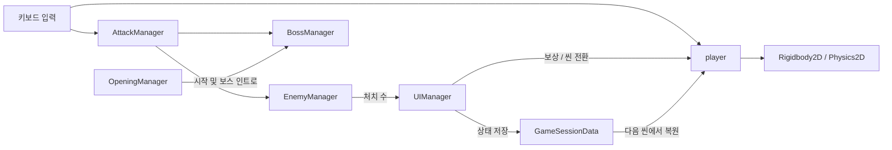

# 2D Action Platformer

Unity와 C#으로 제작한 2D 횡스크롤 액션 게임입니다. 플레이어는 이단 점프와 대시로 이동하고, 검 공격으로 적을 처치해 스테이지 목표를 달성합니다. 마지막 스테이지에서는 체력에 따라 패턴이 바뀌는 보스와 싸웁니다.

이 문서는 프로젝트를 실행하는 방법과 플레이어 조작, 전투 판정, 퀘스트, 보스 패턴 및 스테이지 간 상태 전달의 구현을 설명합니다.

## 개발 환경

| 구분 | 사용 기술 |
| --- | --- |
| 엔진 | Unity 6000.3.16f1 |
| 언어 | C# |
| 입력 | Unity Input System 1.19.0 및 기존 Input API |
| 카메라 | Cinemachine 3.1.7 |
| 물리·맵 | Rigidbody2D, Collider2D, Physics2D, Tilemap |
| UI | Unity UI, TextMesh Pro |

## 실행 방법

1. Unity Hub에서 `2DRougelike` 폴더를 프로젝트로 추가합니다.
2. Unity 6000.3.16f1으로 프로젝트를 열고 패키지 및 에셋 가져오기가 끝날 때까지 기다립니다.
3. `Assets/Scenes/Title.unity`를 열고 Play를 누릅니다.
4. 타이틀 화면에서 게임을 시작합니다.

`ProjectSettings/EditorBuildSettings.asset`에는 `Title`, `Stage 1`, `Stage 2`, `Stage 3` 순서로 씬이 등록되어 있습니다. 스크립트가 씬 이름으로 로드하므로 씬 이름을 바꾸면 관련 로직도 함께 수정해야 합니다.

## 조작 방법

| 입력 | 동작 |
| --- | --- |
| ← / → | 좌우 이동 |
| X | 점프 / 공중에서 이단 점프 |
| C | 스태미나를 소모해 대시 |
| Z | 검 공격 / 콤보 입력 |
| Space | 열쇠를 가진 상태로 클리어 구역에서 상호작용 |

## 게임 진행

1. **Stage 1**: 적 3명을 처치해 퀘스트 보상을 활성화하고 열쇠를 획득합니다.
2. **Stage 2**: 적 5명을 처치해 보상을 활성화하고 출구에서 다음 스테이지로 이동합니다.
3. **Stage 3**: 경고 UI와 보스 등장 연출 후 다크 나이트와 전투합니다.

일반 스테이지에서 보석을 획득하면 강화 UI가 표시됩니다. 강화 선택에는 공격력 증가, 최대 체력 증가, 즉시 회복이 구현되어 있습니다. 적 처치 수와 목표 수치는 [`UIManager.cs`](Assets/Scripts/UIManager.cs)에서 관리합니다.

## 시스템 구조



## 핵심 구현

### 1. 이동·점프·대시

관련 코드: [`player.cs`](Assets/Scripts/player.cs)

- `FixedUpdate()`에서 방향키 입력을 읽어 `Rigidbody2D.linearVelocity`의 수평 성분을 변경합니다. 공격 중에는 이동 입력을 제한합니다.
- 지면 판정은 플레이어 콜라이더 하단에 얇은 상자를 두고 `Physics2D.OverlapBox`와 `groundLayer`로 검사합니다.
- 지면 점프 후 공중에서 한 번 더 점프할 수 있습니다. 이단 점프에는 별도 힘과 애니메이션 클립을 사용합니다.
- 대시는 코루틴에서 일정 시간 속도를 적용하며, 설정에 따라 중력도 잠시 끕니다. 스태미나를 10 소모하고 대기 시간이 지난 뒤 회복합니다.

```csharp
// player.cs: 콜라이더의 바닥 바로 아래에서 지면을 검사
Bounds bounds = bodyCollider.bounds;
Vector2 boxCenter = new Vector2(bounds.center.x, bounds.min.y - (groundCheckDistance / 2f));
Vector2 boxSize = new Vector2(bounds.size.x * 0.9f, groundCheckDistance);

Collider2D hit = Physics2D.OverlapBox(boxCenter, boxSize, 0f, groundLayer);
return hit != null;
```

지면에서 `jumpCount`를 초기화하며, 점프 상승과 하강 상태에 따라 `AnimatorOverrideController`의 클립을 교체합니다.

### 2. 근접 공격과 콤보

관련 코드: [`AttackManager.cs`](Assets/Scripts/AttackManager.cs)

공격 입력을 받으면 애니메이터의 `Attack` 트리거를 실행합니다. 공격 도중 콤보 입력 가능 구간이라면 다음 공격을 예약합니다. `ComboStart`, `ComboEnd`, `EndAttack`은 애니메이션 이벤트와 연결되어 공격 상태를 제어합니다. 기본 최대 콤보 수는 4이며, 공중 공격은 별도 상태로 처리합니다.

피격 판정은 공격 지점 주변의 콜라이더를 탐색하고, 부모에서 일반 적과 보스 컴포넌트를 찾습니다. `HashSet`을 사용해 하나의 적이 여러 콜라이더로 검색되어도 한 번의 판정에서 중복 피해를 받지 않도록 합니다.

```csharp
Collider2D[] hits = Physics2D.OverlapCircleAll(attackPoint.position, attackRadius);
HashSet<EnemyManager> hitEnemies = new HashSet<EnemyManager>();
HashSet<BossManager> hitBosses = new HashSet<BossManager>();

foreach (Collider2D hit in hits)
{
    EnemyManager enemy = hit.GetComponentInParent<EnemyManager>();
    BossManager boss = hit.GetComponentInParent<BossManager>();
    if (enemy != null) hitEnemies.Add(enemy);
    if (boss != null) hitBosses.Add(boss);
}
```

수집된 대상에는 각각 `TakeDamage(pl.dmg)`를 호출합니다. 판정 반경과 공격 지점은 Inspector에서 조정할 수 있습니다.

### 3. 일반 적과 투사체

관련 코드: [`EnemyManager.cs`](Assets/Scripts/EnemyManager.cs), [`EnemyBullet.cs`](Assets/Scripts/EnemyBullet.cs)

- 일반 적은 시작 위치를 기준으로 `moveDistance` 범위에서 좌우 순찰합니다.
- 공격 간격마다 플레이어의 현재 위치를 향하는 방향을 계산해 투사체를 생성합니다.
- 투사체는 초기 방향을 정규화해 매 프레임 이동하며, 플레이어에 닿으면 피해를 주고 제거됩니다. 지면에 닿아도 제거됩니다.
- 적의 체력이 0 이하가 되면 사망 애니메이션과 효과음을 재생하고 `kill_count`를 증가시킨 뒤 오브젝트를 제거합니다.

```csharp
// EnemyManager.cs: 발사 시점의 플레이어 위치를 향하는 방향
GameObject bullet = Instantiate(bulletPrefab, firePoint.position, Quaternion.identity);
Vector2 dir = player_pos.position - firePoint.position;
bullet.GetComponent<EnemyBullet>().Init(dir);
```

### 4. 퀘스트와 보상

관련 코드: [`UIManager.cs`](Assets/Scripts/UIManager.cs), [`ItemManager.cs`](Assets/Scripts/ItemManager.cs), [`player.cs`](Assets/Scripts/player.cs)

`UIManager`는 현재 씬 이름에서 스테이지 번호를 읽어 처치 목표를 정하고, `EnemyManager.kill_count`를 UI에 표시합니다. 목표에 도달하면 비활성 상태의 `ItemManager` 오브젝트를 찾아 활성화합니다. 보상 생성은 `questRewardSpawned`로 한 번만 실행합니다.

```csharp
// UIManager.cs
quest_content.text = $"열쇠 생성을 위한 적 처치 ({EnemyManager.kill_count}/{stageKillGoal})";

if (EnemyManager.kill_count >= stageKillGoal)
{
    Quest_txt.delete_txt();
    SpawnQuestRewards();
}
```

플레이어는 트리거 충돌의 태그를 통해 열쇠, 보석, 회복 포션과 클리어 구역을 구분합니다. 열쇠를 가진 상태에서 클리어 구역에 들어가 `Space`를 누르면 클리어 처리 또는 다음 스테이지 전환을 수행합니다. UI 강화 선택은 공격력 +5, 현재·최대 체력 +10, 즉시 회복 +15로 구현되어 있습니다.

### 5. 보스 등장과 단계별 패턴

관련 코드: [`OpeningManager.cs`](Assets/Scripts/OpeningManager.cs), [`UIManager.cs`](Assets/Scripts/UIManager.cs), [`BossManager.cs`](Assets/Scripts/BossManager.cs)

Stage 3에서는 시작 페이드 후 플레이어 조작을 제한하고 경고 UI를 표시합니다. `BossManager.PlayStage3Intro()`는 Cinemachine Brain을 일시적으로 비활성화한 뒤 카메라를 보스 쪽으로 이동하고 연출을 재생합니다. 이후 카메라를 플레이어 쪽으로 되돌리고 보스 물리 및 조작을 활성화합니다.

보스의 체력 비율이 50% 이하가 되면 2단계로 전환됩니다. 1단계에서는 걷기로 추격하며 근접 범위에서 공격하고, 2단계에서는 달리기로 추격하면서 플레이어와의 수평 거리에 따라 근접 공격 또는 빔 공격을 선택합니다. 각 패턴에는 잠금 상태와 재사용 대기 시간이 적용됩니다.

```csharp
// BossManager.cs
float hpPercent = (float)curHp / maxHp;
return hpPercent <= 0.5f ? 2 : 1;
```

### 6. 스테이지 간 플레이어 상태

관련 코드: [`GameSessionData.cs`](Assets/Scripts/GameSessionData.cs), [`UIManager.cs`](Assets/Scripts/UIManager.cs), [`player.cs`](Assets/Scripts/player.cs)

다음 스테이지로 이동하기 전에 `UIManager.NextStage()`가 플레이어 상태를 정적 `GameSessionData`에 저장합니다. 새 씬의 플레이어는 초기화 시 세션이 활성화되어 있으면 저장된 값을 복원합니다.

저장 항목은 이동·점프 속도, 공격력, 최대·현재 체력, 최대·현재 스태미나, 보호막, 누적 클리어 시간입니다. 새 게임이나 재시작 시 `ResetSession()`으로 세션을 초기화합니다.

```csharp
// UIManager.cs: 씬 전환 전 상태 저장
player playerInstance = GameObject.Find("Player").GetComponent<player>();
if (playerInstance != null)
{
    GameSessionData.SavePlayerState(playerInstance);
}
```

이 데이터는 **실행 중 메모리에 유지되는 세션 상태**입니다. 게임을 종료한 후 이어하기 위한 디스크 저장 기능은 아닙니다. 최고 클리어 시간은 별도로 `PlayerPrefs`에 저장합니다.

## 주요 스크립트

| 파일 | 역할 |
| --- | --- |
| [`player.cs`](Assets/Scripts/player.cs) | 이동, 점프, 대시, 체력·스태미나, 상호작용, 클리어 |
| [`AttackManager.cs`](Assets/Scripts/AttackManager.cs) | 공격 상태, 콤보, 범위 판정과 피해 전달 |
| [`EnemyManager.cs`](Assets/Scripts/EnemyManager.cs) | 일반 적 순찰, 투사체 발사, 피격·사망 |
| [`EnemyBullet.cs`](Assets/Scripts/EnemyBullet.cs) | 투사체 이동과 충돌 처리 |
| [`BossManager.cs`](Assets/Scripts/BossManager.cs) | 보스 인트로, 체력, 페이즈와 공격 패턴 |
| [`UIManager.cs`](Assets/Scripts/UIManager.cs) | 퀘스트, 강화, 보상, 보스 경고와 씬 전환 |
| [`GameSessionData.cs`](Assets/Scripts/GameSessionData.cs) | 씬 전환 시 플레이어 상태 저장·복원 |
| [`OpeningManager.cs`](Assets/Scripts/OpeningManager.cs) | 스테이지 시작 페이드와 보스 연출 연결 |
| [`titleManager.cs`](Assets/Scripts/titleManager.cs) | 새 게임 시작과 게임 종료 |
| [`BGMManager.cs`](Assets/Scripts/BGMManager.cs) | 배경음 및 Stage 3 전용 음악 처리 |

## 디렉터리 구조

```text
Assets/
├── Scenes/       # 타이틀 및 3개 스테이지
├── Scripts/      # 플레이어, 전투, 적, UI, 세션 로직
├── Prefabs/      # 재사용 오브젝트
├── Animation/    # 애니메이션 클립과 컨트롤러
├── TileMap/      # 스테이지 타일맵
├── Resources/    # 아트, 사운드, 프리팹 등
└── Settings/     # 프로젝트 렌더링 관련 설정
```

## 에셋

프로젝트에는 외부 에셋이 포함되어 있습니다. 재배포 또는 상업적 이용 전 각 에셋에 포함된 라이선스와 사용 조건을 확인해 주세요.
