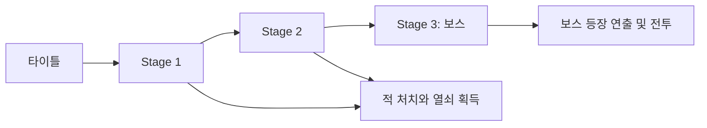
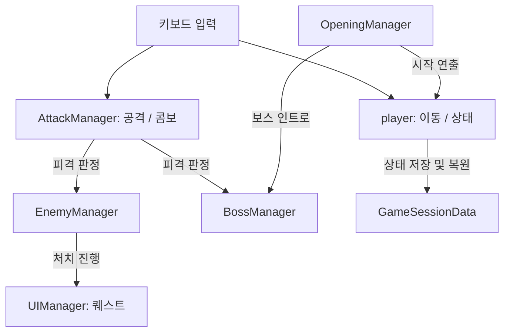

# 2D Action Platformer

Unity로 제작한 2D 액션 플랫폼 게임입니다. 플레이어는 점프와 대시로 스테이지를 이동하고, 검 공격으로 적을 처치하며 마지막 스테이지에서 보스와 대결합니다.

## 실행 환경

- Unity 6000.3.16f1
- Unity Input System 1.19.0, Cinemachine 3.1.7
- Unity Hub에서 이 폴더를 프로젝트로 열고 `Assets/Scenes/Title.unity`를 실행합니다.

## 조작

| 키 | 동작 |
| --- | --- |
| ← / → | 이동 |
| X | 점프 / 이단 점프 |
| C | 대시 |
| Z | 검 공격 및 콤보 |
| Space | 조건을 충족한 클리어 구역에서 상호작용 |

## 게임 흐름



## 주요 코드

- [`player.cs`](Assets/Scripts/player.cs): Rigidbody2D 기반 이동, 지면 판정, 이단 점프, 대시와 스태미나, 피격 및 클리어 처리
- [`AttackManager.cs`](Assets/Scripts/AttackManager.cs): 공격 애니메이션 이벤트와 콤보 입력, OverlapCircleAll을 이용한 적·보스 피격 판정
- [`EnemyManager.cs`](Assets/Scripts/EnemyManager.cs): 일반 적의 순찰, 투사체 공격, 체력과 사망 처리
- [`BossManager.cs`](Assets/Scripts/BossManager.cs): 보스 인트로, 체력과 단계별 공격 패턴
- [`UIManager.cs`](Assets/Scripts/UIManager.cs): 퀘스트 진행, 보상 및 보스 경고 UI
- [`GameSessionData.cs`](Assets/Scripts/GameSessionData.cs): 스테이지 전환 시 플레이어 능력치와 진행 시간 전달
- [`OpeningManager.cs`](Assets/Scripts/OpeningManager.cs): 페이드 인과 스테이지 시작 연출

## 구조



## 디렉터리

```text
Assets/
├── Scenes/       # Title, Stage 1, Stage 2, Stage 3
├── Scripts/      # 게임 로직
├── Prefabs/      # 재사용 오브젝트
├── Animation/    # 애니메이션
├── TileMap/      # 스테이지 타일맵
└── Resources/    # 게임 에셋과 런타임 로드 리소스
```

외부 에셋은 각 에셋에 포함된 라이선스와 사용 조건을 확인하세요.
